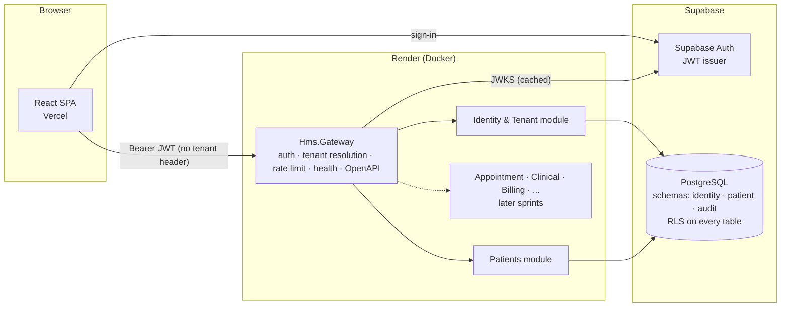

# Architecture overview

_Owner (simulated): CTO / Solution Architect. Status: Sprint 0 (historical)._

> Current shape: [microservices.md](architecture/microservices.md). `Hms.Gateway` and
> `infra/docker/api.Dockerfile` are removed. The App Service `medicore-hms-api` is stopped.
> The cutover is done ([monolith-cutover.md](runbooks/monolith-cutover.md)).

## Shape: a modular monolith with service boundaries

The brief (section 6) lists twelve logical services. For free-tier hosting we run **one** ASP.NET Core process (the gateway) that hosts independent modules. Each module owns:

| Concern | Rule |
|---|---|
| Code | Its own class library: `backend/modules/<Service>/Hms.Modules.<Service>` |
| Data | Its own PostgreSQL schema (`identity`, `patient`, ...) and its own `DbContext` |
| API | Its own route group under `/api/v1/...` |
| Dependencies | Only `Hms.SharedKernel`. Modules never reference each other. |
| Events (planned) | A transactional outbox table per schema, introduced with the first cross-module workflow |

These rules mean any module can later be pulled out into its own deployable service: give it its own host, keep its schema, and swap in-process calls for HTTP or events.

## Service status

| Service (brief §6) | Schema | Status (Sprint 1) |
|---|---|---|
| Identity & Tenant | `identity` | Tables, RLS, helpers, access token hook, active context, EF mapping, tenant resolution, `/me`, `/me/context`, `/tenants/current`, branches and members admin |
| Patient | `patient` | Patient registry table, RLS, list/get/create endpoints, registration UI |
| Audit | `audit` | Append-only `audit_log` populated by triggers. No API yet. |
| Appointment, Clinical, Billing, Pharmacy, Inventory, Laboratory, Admission, Notification, Reporting | — | Not started (roadmap sprints 2+) |

## Request pipeline (gateway)

`ForwardedHeaders → ExceptionHandler → SecurityHeaders → Serilog request logging → (Swagger in Development) → CORS → Authentication (JWT) → TenantResolution → RateLimiter → Authorization → endpoints`

- **Authentication:** JWT bearer against Supabase Auth: JWKS (ES256/RS256) with optional HS256 legacy secret, issuer `<url>/auth/v1`, audience `authenticated`, `role = authenticated`. If `Auth:Supabase:ProjectUrl` is unset, every token is rejected (fail closed). See [auth-flow.md](auth-flow.md).
- **Database access:** the API connects as `hms_api_login` (member of `hms_api`, no direct privileges). Every request transaction switches to `authenticated` with the validated claims, so RLS applies to API traffic. See [multi-tenancy-and-security.md](multi-tenancy-and-security.md).
- **Tenant resolution:** see [multi-tenancy-and-security.md](multi-tenancy-and-security.md).
- **Health:** `/health/live` checks the process only. `/health/ready` also checks the database (`DbContextCheck`).
- **Logging:** compact JSON to stdout. `TenantId` and `UserId` are attached through a logging scope. Request bodies are never logged.
- **OpenAPI:** `/openapi/v1.json` and Swagger UI at `/swagger`. Both are on in Development, and off by default elsewhere (`OpenApi:Enabled`).

## Data ownership and migrations

- `supabase/migrations/*.sql` is the **single source of truth** for the schema. EF Core maps the existing tables (snake_case naming convention). EF migrations are not used.
- `Hms.DatabaseTests` checks that the EF model matches the migrated schema.

## Frontend

- `apps/web` is a Vite SPA. Routes: `/login`, `/` (dashboard), `/patients`, `/patients/new`, `/admin/branches`, `/admin/members` (tenant admins), and a 404 page inside the shell.
- The typed API client (`src/lib/api/client.ts`) attaches the bearer token and **never sends a tenant header**.
- Supabase Auth via `supabase-js` (`AuthProvider`). The tenant/branch switcher is driven by `GET /api/v1/me`, and switching goes through `POST /api/v1/me/context` followed by a session refresh.

## Deployment targets (not deployed)

| Component | Target | Config |
|---|---|---|
| Web | Vercel | `infra/vercel/vercel.json` |
| API | Render (Docker, free plan) | `infra/render/render.yaml`, `infra/docker/api.Dockerfile` |
| DB | Supabase Free | `supabase/migrations` |
| Local | Docker Compose | `docker-compose.yml` |
