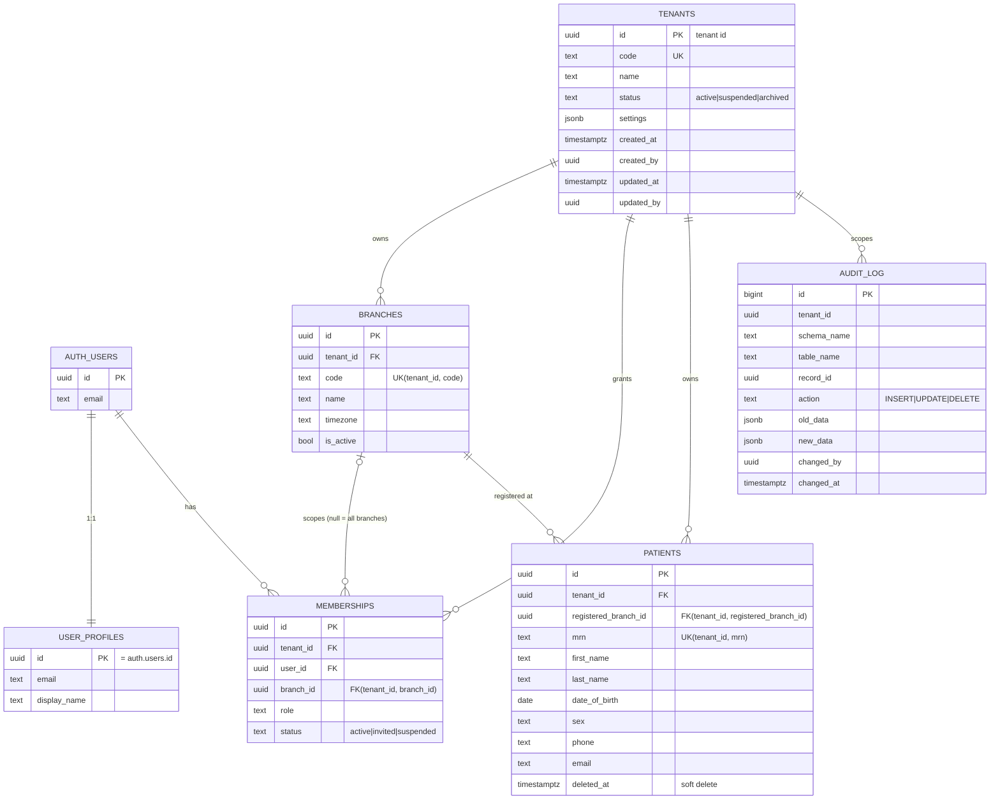

# Entity relationship diagram (Sprint 0)

Source of truth: `supabase/migrations/`. `auth.users` is provided by Supabase Auth.

All tables except `audit_log` also carry `created_at, created_by, updated_at, updated_by`.

## Schemas

| Schema | Service | Tables |
|---|---|---|
| `identity` | Identity & Tenant | tenants, branches, user_profiles, memberships |
| `patient` | Patient | patients |
| `audit` | Audit | audit_log |
