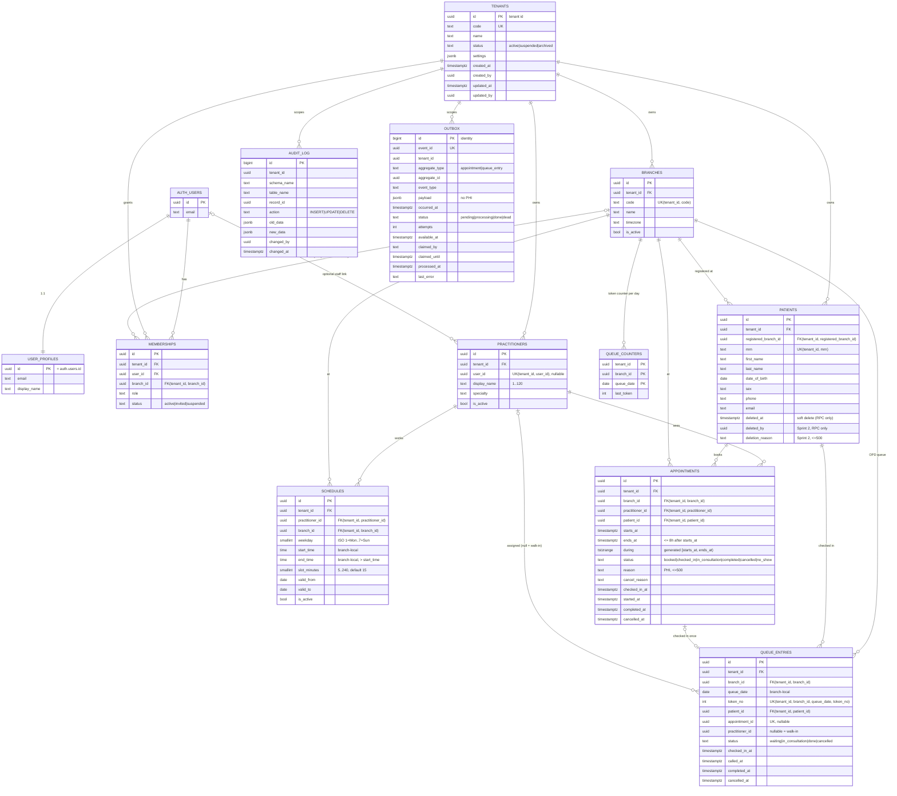

# Entity relationship diagram (Sprint 0–2)

Source of truth: `supabase/migrations/`. `auth.users` is provided by Supabase Auth.

All tables except `audit_log`, `queue_counters` and `outbox` also carry `created_at, created_by, updated_at, updated_by` (DB-managed; never sent by the API).

## Schemas

| Schema | Service | Tables |
|---|---|---|
| `identity` | Identity & Tenant | tenants, branches, user_profiles, memberships |
| `patient` | Patient | patients |
| `appointment` | Appointments & OPD queue (Sprint 2) | practitioners, schedules, appointments, queue_entries, queue_counters |
| `messaging` | Transactional outbox (Sprint 2) | outbox |
| `audit` | Audit | audit_log |

## Sprint 2 constraints and rules

Source: `/workspace/SPRINT2-CONTRACT.md` (DB v1) and migrations `20261010090000`–`20261010090300`.

- **Tenancy.** Every new table has `tenant_id`; child rows reference parents through composite FKs `(tenant_id, x_id)`, so no row can point at another tenant's row. RLS is on for every table.
- **Patients (2.1).** Soft delete and restore only through `patient.soft_delete_patient(id, reason)` (tenant_admin, receptionist) and `patient.restore_patient(id)` (tenant_admin); `authenticated` has no `update (deleted_at)` grant. Deleted rows are visible to tenant_admin only and can't be edited until restored. The MRN stays reserved after delete. Deleting a patient with open appointments or queue entries fails (`55000`). Indexes: normalized phone (`patient.normalize_phone`, last 10 digits), DOB, and lower(name)+DOB, all `where deleted_at is null`.
- **Duplicate detection.** `patient.find_duplicate_patients(...)` (SECURITY INVOKER) returns up to 20 same-tenant, non-deleted matches by name+DOB or normalized phone, with `match_reasons`. Advisory only; the DB never blocks a duplicate.
- **Schedules.** Weekly, branch-local wall-clock time, no overnight shifts; overlapping active rows for one practitioner are excluded (`23P01`). Slots are computed by `appointment.available_slots(...)`, never stored (max 31-day range).
- **Appointments.** No overlap per practitioner: `exclude using gist (tenant_id =, practitioner_id =, during &&)` for status `booked|checked_in|in_consultation|completed` (`23P01`; cancelled and no_show free the time). Patient-side overlap is not enforced. New rows must be `booked`; transitions are enforced by a trigger (`23514 invalid_transition:...`); time, practitioner, patient and branch are immutable once not `booked`. No DELETE (cancel instead).
- **OPD queue.** Written only by `appointment.check_in(...)` and `appointment.set_queue_status(...)`. Tokens are per (tenant, branch, branch-local date) from 1, allocated atomically through `queue_counters` (no client grants); an appointment is checked in at most once and only on its branch-local day. Queue reads are branch-scoped.
- **Outbox.** Written only by AFTER triggers on appointments and queue entries (same transaction), payload has no PHI; consumed by the `hms_dispatcher` role through `claim_outbox` / `complete_outbox` / `fail_outbox` with SKIP LOCKED leases. Delivery is at-least-once; dedupe on `event_id`.
- **Deferred.** Branch-role binding (`has_branch_role`) is still enforced in the API only; see `docs/backlog/pr1-db-hardening-draft.sql`.
