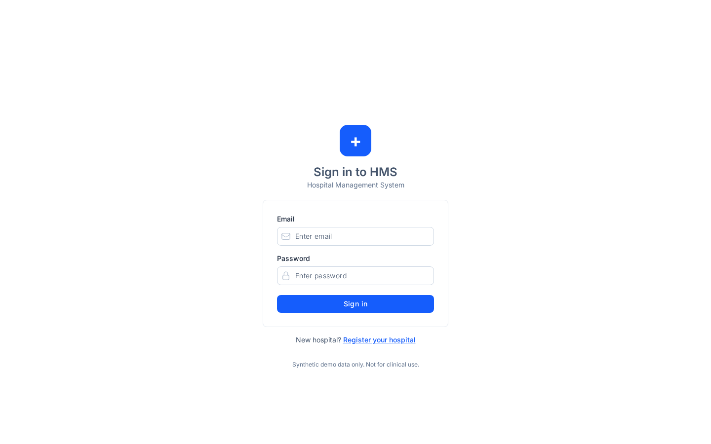

# MediCore HMS user manual

Plain-language guides for hospital staff, one per role. Every screen, menu and button named here exists in the app today (checked against the code on `main` at 05b32c5, 25 Oct 2026). Screenshots come from the live demo site and show synthetic demo data only.

| Your role (as shown in the app) | Guide |
|---|---|
| tenant admin (hospital admin / owner) | [Hospital admin](tenant-admin.md) |
| receptionist | [Reception](reception.md) |
| nurse | [Nurse](nurse.md) |
| doctor | [Doctor](doctor.md) |
| billing | [Billing / cashier](billing.md) |
| accountant | [Accountant (CA)](accountant.md) |
| pharmacist, lab technician, viewer, platform operator | [Other roles](other-roles.md) |

There is no separate "owner" role: the hospital owner uses the **tenant admin** role.

## Signing in (all roles)

1. Open the HMS web address your hospital gave you (demo: https://medicore-hms-three.vercel.app).
2. On **Sign in to HMS**, enter your **Email** and **Password** and press **Sign in**.
3. New staff get an invitation from the hospital admin. Open the invite link, accept it, then sign in.
4. The top bar shows your hospital, the **Branch** you are working in, and your role. Change the branch from the branch picker if you work at more than one.
5. Press **Sign out** (top right) when you leave the desk. If you are idle for a while, HMS signs you out by itself and shows: "You were signed out after a period of inactivity. Sign in again to continue."

Useful anywhere: the search icon in the top bar opens the command palette, and the keyboard icon lists shortcuts (for example `/` for Patients, Alt+K to book, Alt+C for Check-in, Alt+Q for the OPD queue, Alt+D for the Hospital desk).

## Common messages (all roles)

| Message | What it means | What to do |
|---|---|---|
| You don't have access to this page. Your role in this hospital does not include access to this page. | Your role does not include this screen. | Ask your hospital admin to change your role if you need it. |
| You are not allowed to … at this branch. | You do not have that role at the branch selected in the top bar. | Switch branch, or ask your admin for branch access. |
| Your session has expired. Sign in again. | You were signed out. | Sign in again. |
| Someone else changed this patient. Reload and try again. | Two people edited the same record. | Reload the page and redo your change. |
| … is unavailable right now / Could not load … | The server is busy or waking up. | Wait a few seconds and try again. |
| This email is already registered. Please sign in or contact support. | (Hospital sign-up) the work email already has an account. | Sign in instead. |
