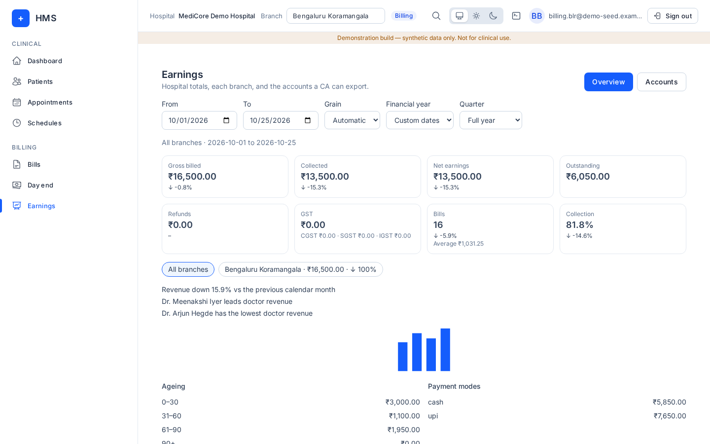

# Accountant (CA)

## What you can and cannot do
Menus: **Dashboard, Schedules, Earnings**.

You can read the **Earnings** dashboard for the whole hospital or one branch, and download every register. It is read-only.

You cannot see patients, appointments, bills, the queue or any administration screen, and you cannot change money.

## How to log in
See [Signing in](README.md#signing-in-all-roles). Your admin adds you in **Members** with the role **accountant**.

## Daily tasks

### Earnings – Overview
1. **Billing → Earnings**. Choose **All branches** or **One branch**.
2. Pick dates: **From**/**To**, a **Financial year** (e.g. 2026–27) with a **Quarter** (Q1 Apr–Jun … ) or **Full year**, or **Custom dates**. **Grain**: Automatic, day, week or month.
3. Read **Gross billed**, **Collected**, **Refunds**, **Net earnings**, **Outstanding**, **GST**, **Bills**, the **Gross billed trend**, **Ageing** and **Payment modes**.

(Screenshot taken with a billing login; the accountant sees the same page.)

### Accounts tab (for the CA)
Open **Accounts** to see the **GST summary** (by GSTIN and month: B2C taxable, B2B taxable, CGST, SGST, IGST, credit notes) and the **Sales register**.

Downloads: **Sales register CSV**, **Sales register Excel**, **GST summary CSV**, **HSN summary CSV**, **Credit notes CSV**, **Receipts CSV**, **Refund register CSV**, **Day-end cash CSV**, **Ageing CSV**, and **All accounts Excel**.

If you see "A register was cut at 500 rows. Narrow the dates to export the rest.", export in smaller date ranges.

## Common errors and FAQ
- "The earnings report could not be loaded." Try again in a moment.
- "No bills in this period." Nothing was billed in those dates.
- **Can I see patient names?** Only as they appear on registers (e.g. the sales register).
- **Is there a Tally export?** Not yet; use the Excel/CSV files.
