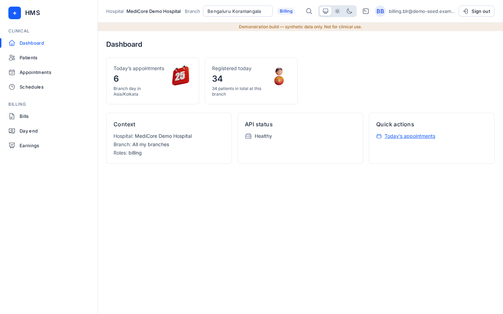
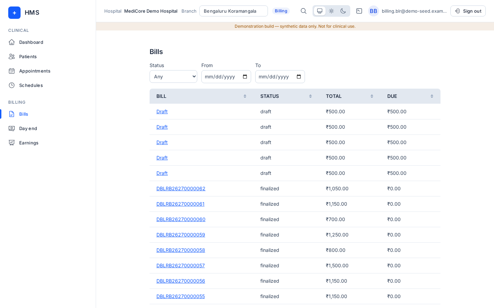
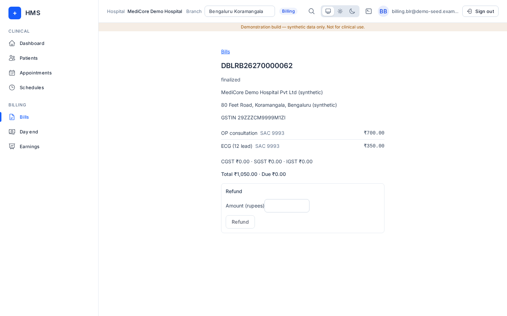
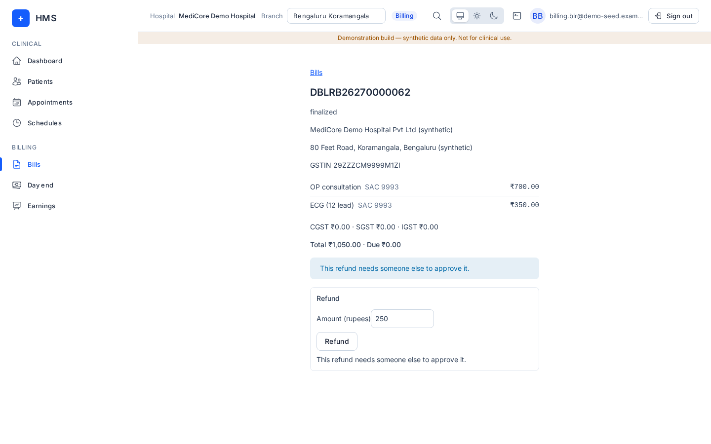
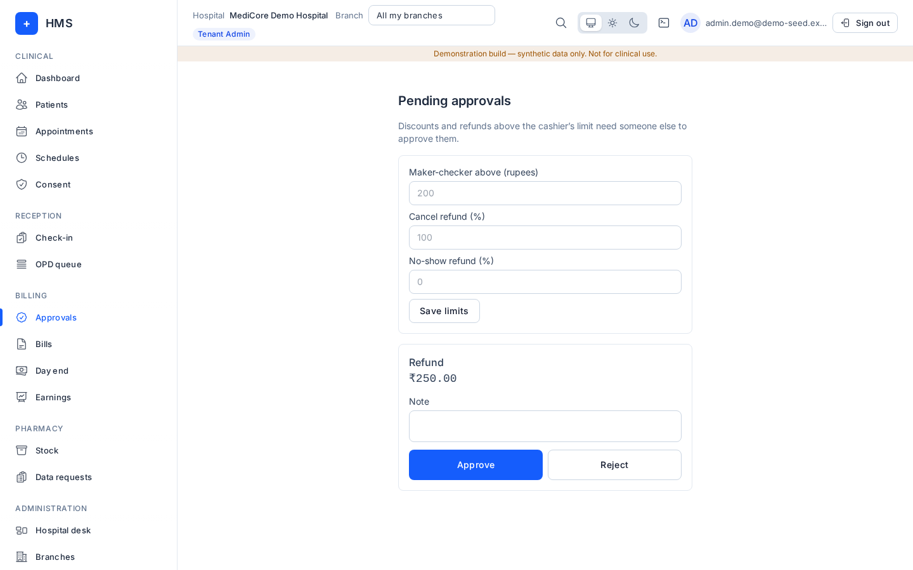
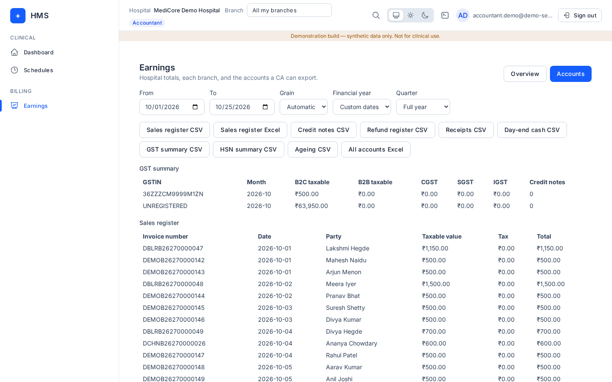
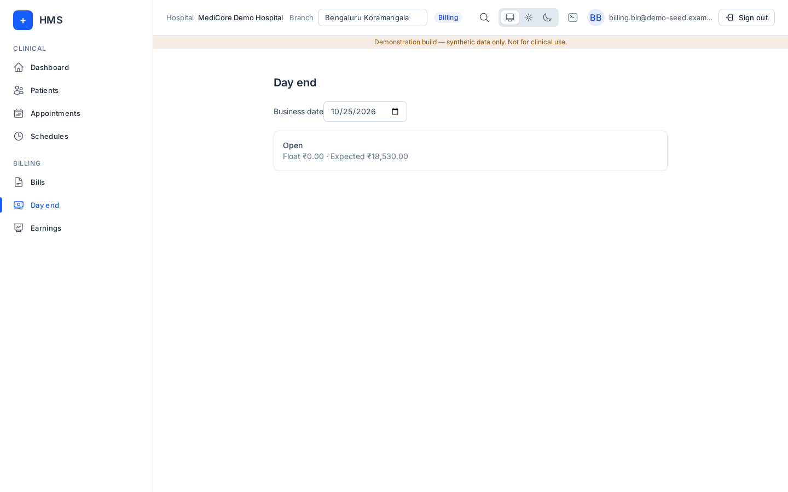

# Billing / cashier

## What you can and cannot do
Menus: **Dashboard, Patients, Appointments, Schedules, Bills, Day end, Earnings**.

You can view patients and appointments; open bills, add services, close bills, take cash/UPI/payment links, apply advances, request discounts and record refunds; see Day end and the Earnings dashboard.

You cannot: approve discounts or refunds above the limit (**Approvals** is admin-only), reconcile a counter, register patients, check in, or use administration screens.

## How to log in
See [Signing in](README.md#signing-in-all-roles). Pick your counter's branch in the top bar.

## Daily tasks

### Find a bill
**Bills**: filter by **Bill status** (Any, Draft, Finalized, Cancelled draft) and **From**/**To** dates. Click a bill to open it.

### Work a bill
A consultation bill is raised automatically at check-in, for booked appointments and walk-in tokens alike. The consultation line carries the visit's doctor and that doctor's fee. If the patient has no open bill today, the billing panel shows **Add consultation** and **Other services**; nothing is billed until you pick one. On the bill:
1. **Add a service**: **Find a service** (dressing, certificate, lab…), choose it. The rate comes from the branch or hospital price list.
2. GST is worked out from the service category. Set **Place of supply** on the bill page and **Save place of supply** if the patient is from another state.
3. **Request discount**: enter **Discount rupees**. Above the limit you see "This discount is above the limit. Someone else has to approve it."
4. Take payment while **Due** is shown:
   - **Cash** (a counter session opens automatically for your branch).
   - **Show UPI QR**: the patient scans; the screen shows "Waiting for payment" until it lands.
   - **Share payment link**: enter **Phone**, press **WhatsApp** or **SMS**.
   - **Apply advance** appears when the patient has an advance on account.
5. Press **Close bill** to finalize. **View receipt** opens the receipt. **New bill** starts another.

### Refunds and credit notes
1. Open the finalized bill. In **Refund**, pick the receipt, enter **Refund rupees**, press **Refund**.
2. HMS shows "Refund R… Credit note CN…". A credit note is created automatically when needed.
3. If it needs a second person you see "This refund needs someone else to approve it." An admin approves it in **Approvals**.

### Day end
**Day end**: pick the **Business date**. Each counter shows its status, **Float**, **Expected** cash, and once closed, **Counted** and **Variance**. An admin presses **Reconcile** on a closed counter.

### Earnings
You can open **Earnings** too. See [Accountant](accountant.md).
The **Earnings by category** panel splits service revenue into Consultations, Procedures, Lab and Other (pharmacy, consumables and anything uncategorised), with each one's share. Credit notes are not counted.

## Common errors
| Message | Meaning |
|---|---|
| Open a counter session before taking cash. | The counter for this branch could not be opened; check the branch and retry. |
| The bill could not be updated. Try again. | Network or server hiccup. |
| Enter the refund in rupees. | Amount missing or not a number. |
| Bill not found. | Wrong branch or the bill was cancelled. |

## FAQ
- **Who approves big discounts?** A tenant admin, in **Approvals**.
- **Can I edit a closed bill?** No; refund against it instead.
- **What do Cancel refund % and No-show refund % mean?** The share of a prepaid fee returned on cancellation or no-show; the admin sets them.
