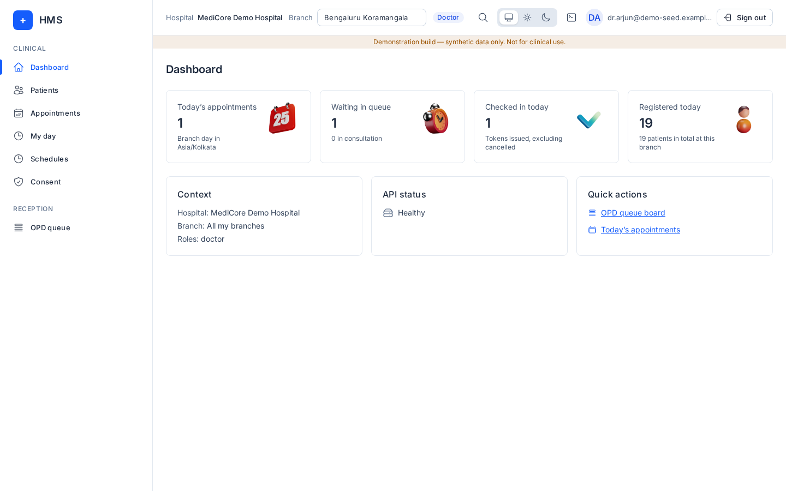
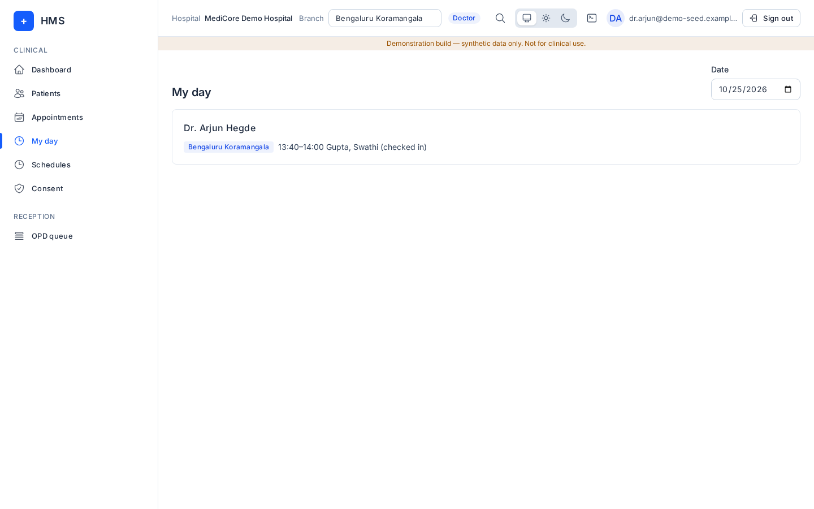
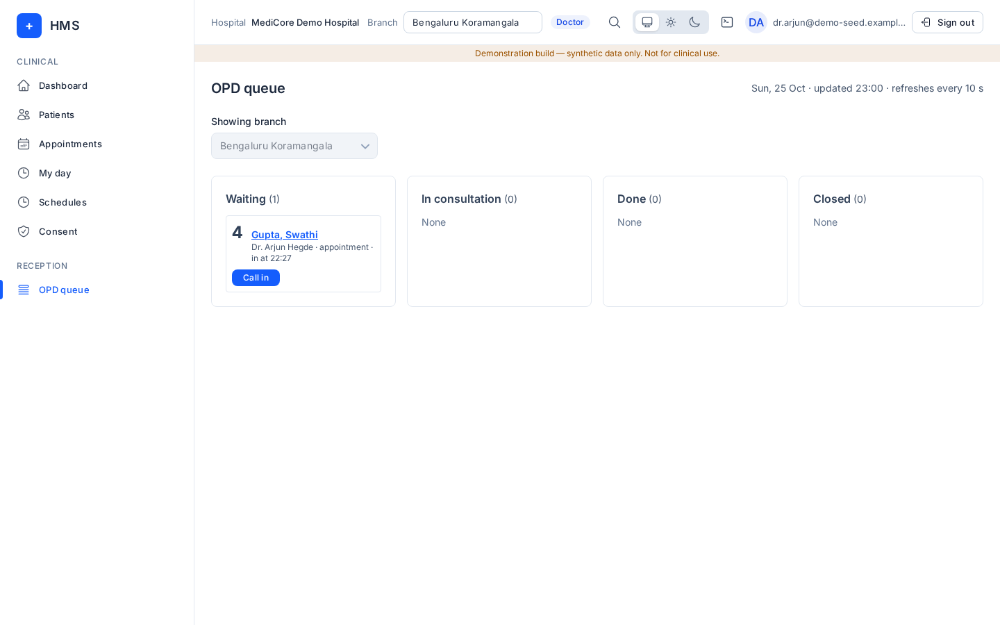

# Doctor

## What you can and cannot do
Menus: **Dashboard, Patients, Appointments, My day, Schedules, Consent, OPD queue**.

You see your own appointments and queue. You can **Call in** and **Mark done** your own tokens, book a **follow-up** of a visit you saw, and mark your own patients as no-show. Patient lists are limited to the patients you are allowed to see.

You cannot register, edit or delete patients, book new (non-follow-up) appointments, cancel or reschedule, check patients in, or open billing and administration screens.

Your login must be linked to your practitioner record by the admin. If not, you see "Your login is not linked to a practitioner".

## How to log in
See [Signing in](README.md#signing-in-all-roles).

## Daily tasks

### My day
**My day** lists your appointments for the chosen **Date** with their status (for example "checked in").

### Queue and consult
1. **OPD queue**: your waiting tokens appear under **Waiting**.
2. Press **Call in** to start the consultation (moves to **In consultation**).
3. Press **Mark done** when finished.
4. To see the patient again, press **Book follow-up** on the token or visit, pick a slot and confirm.

### Your patients
**Patients**: search and open a chart to see demographics and **Visits**. Editing is done by reception.

## Common errors
| Message | Meaning |
|---|---|
| Doctors can only book a follow-up of an earlier visit, at a branch they can access. | New bookings go through reception. |
| Your login is not linked to a practitioner, so this calendar stays empty. | Ask the admin to link your staff account in Practitioners. |
| You don't have access to this page (Bills) | Billing is not part of the doctor role. |

## FAQ
- **Why don't I see all patients?** Doctors see only their own patients.
- **Can I write prescriptions or notes?** Not in this version; there is no consultation-notes screen yet.
