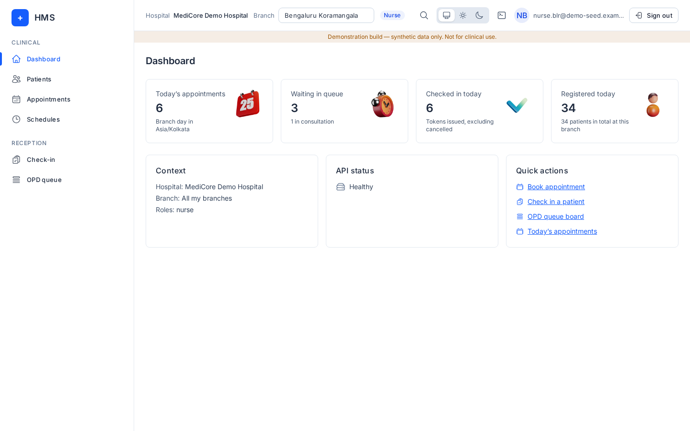
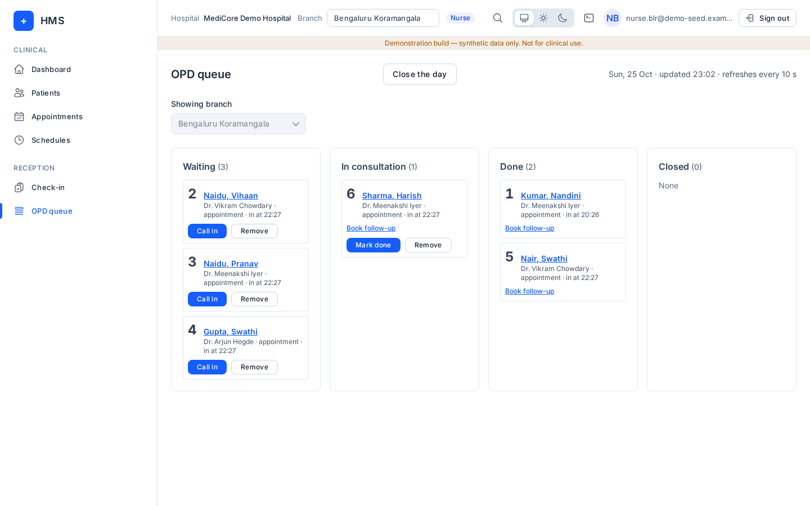

# Nurse

## What you can and cannot do
Menus: **Dashboard, Patients, Appointments, Schedules, Check-in, OPD queue**.

You can view patients, book appointments, check patients in, mark no-shows and run the OPD queue (call in, mark done, remove, close the day).

You cannot register or edit patients, reschedule or cancel appointments, or open any billing, consent or administration screen.

## How to log in
See [Signing in](README.md#signing-in-all-roles).

## Daily tasks
- **Check patients in**: **Check-in** → today's appointments, or **Issue walk-in token**. Same steps as [Reception](reception.md#check-in-and-token).
- **Run the queue**: **OPD queue** → **Call in**, **Mark done**, **Remove**, **Close the day**.
- **Book**: **Appointments → Book appointment** → practitioner, visit type, date, start time → **Confirm booking**.

## Common errors and FAQ
- "You don't have access to this page" on Bills or Patients → Register: those are reception or billing tasks.
- "Token … was already updated elsewhere": someone else moved it; the board refreshes.
