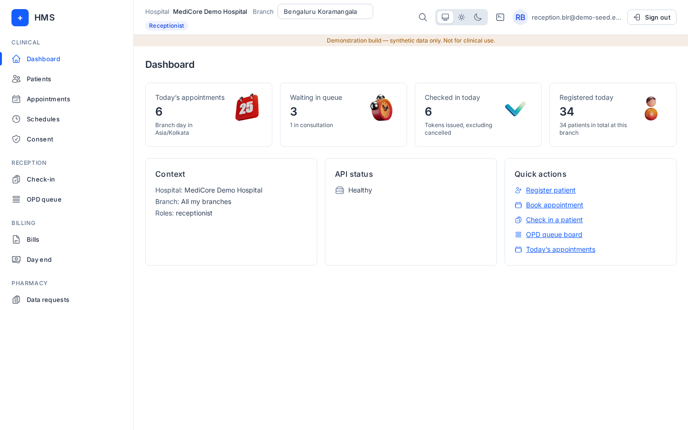
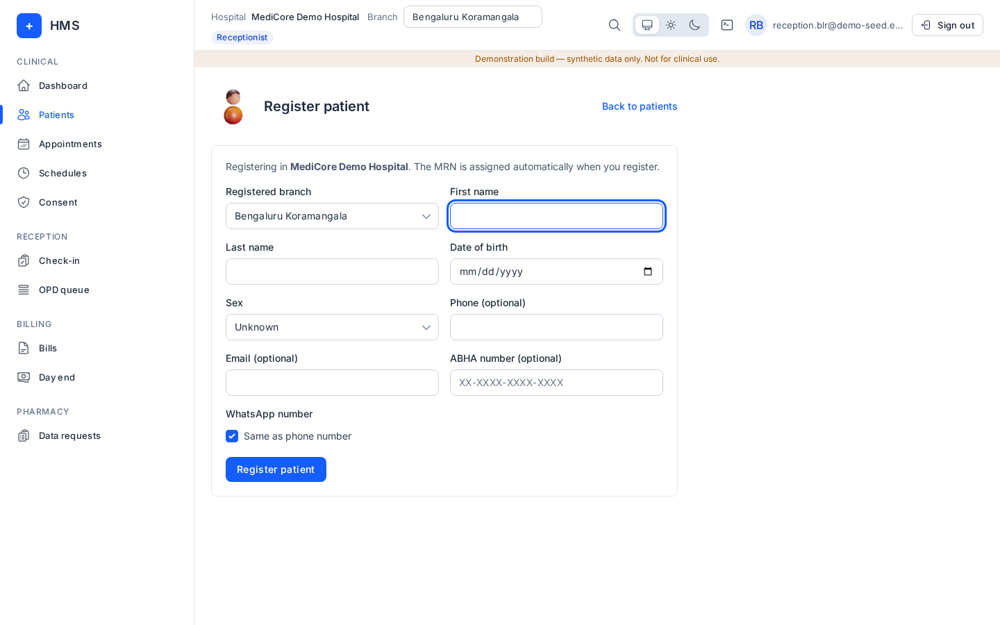
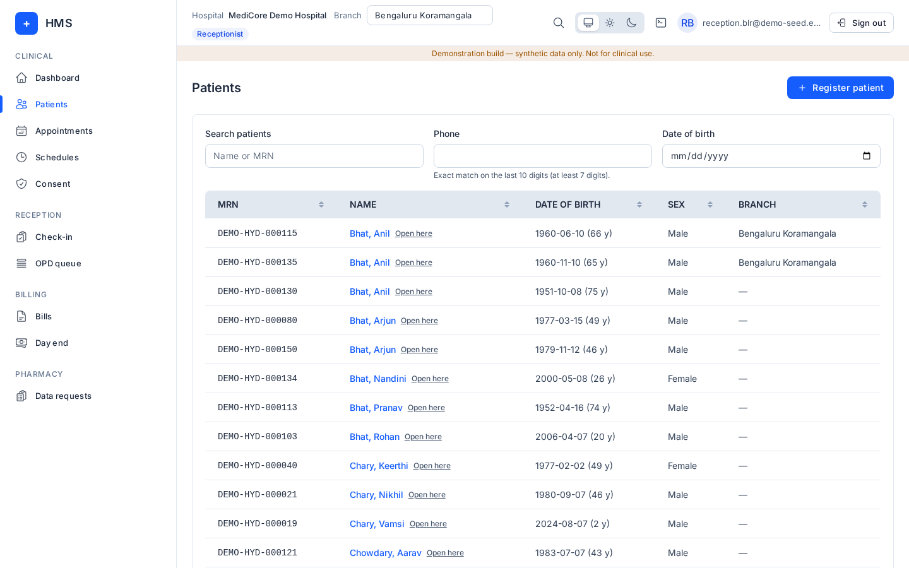
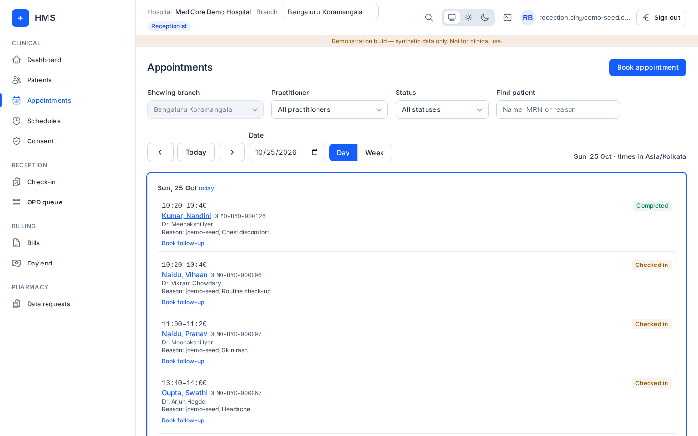
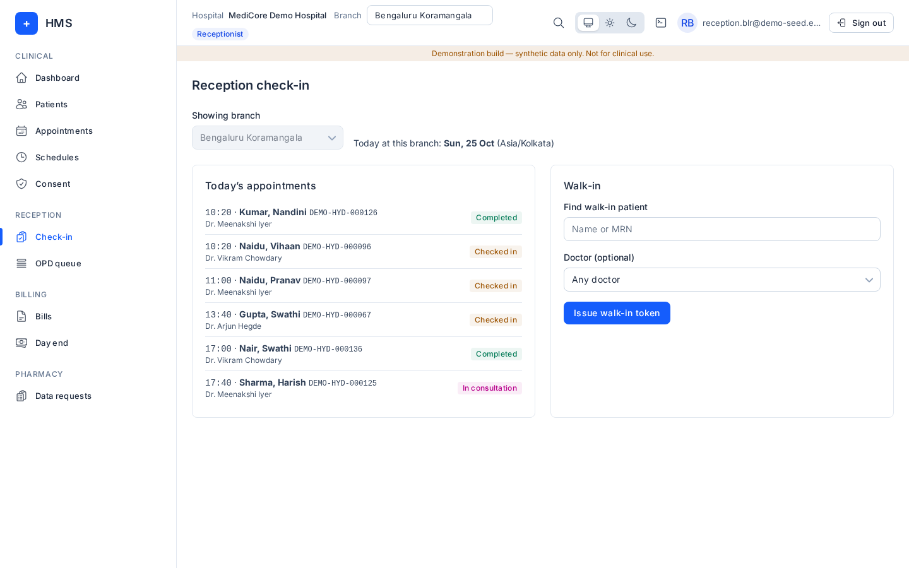
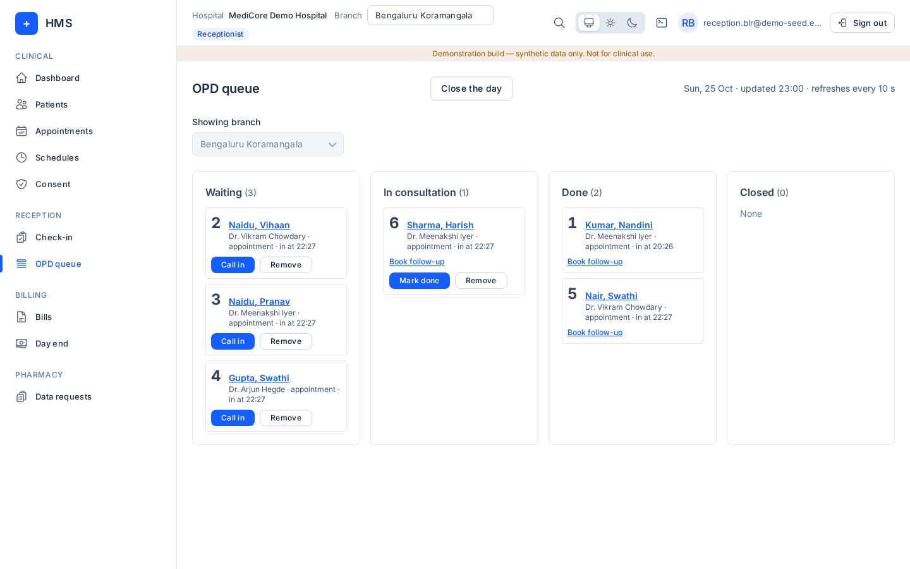

# Reception (receptionist)

## What you can and cannot do
Menus you see: **Dashboard, Patients, Appointments, Schedules, Consent, Check-in, OPD queue, Bills, Day end, Data requests**.

You can register, edit and delete patients; book, reschedule, cancel and mark no-shows; check patients in and run the queue; raise bills, take payment and request discounts; record consent and log privacy requests.

You cannot: open **Earnings**, **Approvals** or the **Administration** menu; restore deleted patients or merge patients; refund money; approve discounts; book outside a doctor's working hours.

## How to log in
See [Signing in](README.md#signing-in-all-roles). Check the **Branch** in the top bar is your desk's branch.

## Daily tasks

### Register a patient
1. **Patients → Register patient** (or the shortcut).
2. Choose **Registered branch**, then **First name**, **Last name**, **Date of birth**, **Sex**, and optionally **Phone**, **Email**, **ABHA number** and WhatsApp.
3. Record the patient's consent choices on the same form.
4. Press **Save patient**, or **Save & book** to go straight to booking. The MRN is assigned automatically.

### Duplicate warnings
Before saving, HMS checks for existing patients:
- **Possible duplicate patient**: someone similar exists. Open the existing chart, or if it really is a different person, fill **Why this is a different person** and press **Register anyway**.
- **This patient already has a chart**: the phone, email or ABHA number already belongs to a patient. Use that chart. Only an admin can merge duplicates.

### Find a patient
**Patients**: search by name or MRN, **Phone** (last 10 digits, at least 7), or **Date of birth**.

### Book an appointment (with a visit type)
1. **Appointments → Book appointment** (Alt+K).
2. Pick the patient, **Practitioner**, **Visit type**, **Appointment date** and a free **Start time**. Add an optional reason.
3. Press **Confirm booking**.
4. For a follow-up of an earlier visit, use **Book follow-up** on that visit; it is linked to the earlier one.

### Reschedule, cancel or no-show
In **Appointments**, open the booking:
- **Reschedule**: pick a new slot.
- **Cancel appointment**: confirm, optional reason. Only booked (not yet checked-in) appointments can be cancelled.
- **Mark as no-show**: only after the appointment time has started.

### Check-in and token
1. **Check-in** (Alt+C). **Today's appointments** for the branch are listed; check the patient in.
2. Walk-in: **Find walk-in patient**, optional **Doctor (optional)** (or **Any doctor**), then **Issue walk-in token**.
3. After check-in the bill panel opens (see [Billing](billing.md) for taking payment).

### OPD queue
**OPD queue** (Alt+Q) shows **Waiting**, **In consultation**, **Done** and **Closed**, refreshing every 10 seconds.
- **Call in** sends the next token to the doctor; **Mark done** finishes; **Remove** takes a token off.
- At the end of the day press **Close the day**, then confirm **Expire waiting tokens**.

### Bills at the desk
You can open **Bills**, take **Cash**, show a **UPI QR**, **Share payment link** (WhatsApp or SMS) and **Request discount**. Refunds and approvals are for billing staff and admins. See [Billing](billing.md).

## Common errors
| Message | Meaning |
|---|---|
| Could not check for existing patients. Registration did not continue. | The duplicate check failed; try again. |
| That slot was just booked for this practitioner. Pick another slot. | Someone else took it. |
| The doctor is not working at that time. Pick a free slot. | Outside working hours; only an admin can override. |
| This patient has open appointments or is in today's queue. Cancel those first. | Shown when deleting a patient. |
| Your role at this branch cannot check patients in. | Wrong branch in the top bar. |

## FAQ
- **Can I fix a duplicate myself?** No, ask an admin to use **Merge patient**.
- **A deleted patient came back to the desk.** Ask an admin to restore them.
- **Can I refund?** No, billing staff or an admin can.
