# Hospital admin (tenant admin / owner)

## What you can and cannot do
You can use every hospital screen: **Dashboard, Patients, Appointments, Schedules, Consent, Check-in, OPD queue, Approvals, Bills, Day end, Earnings, Stock, Data requests**, and the whole **Administration** menu: **Hospital desk, Branches, Members, Practitioners, Working hours, Visit types, Hospital settings, Price list, Privacy notices**.

Only you can: approve discounts and refunds above the limit, set the maker-checker limits, merge duplicate patients, restore deleted patients, book outside a doctor's working hours, and reconcile a counter at day end.

You cannot see other hospitals, or the **Platform** menu (that is for the MediCore operations team).

## How to log in
See [Signing in](README.md#signing-in-all-roles). The first time you sign in after your hospital is approved, HMS opens **Set up your hospital**.

## Daily and setup tasks

### Setup wizard (first sign-in)
**Set up your hospital** has five steps:
1. **Hospital profile**: hospital name, hospital time zone and default country code. Press **Save and continue**.
2. **Branch**: add your first branch (name, code, time zone, legal name, address, GSTIN).
3. **Staff**: invite staff. This is optional ("You can do it later from Members"). Press **Continue**.
4. **Schedule**: add a doctor's weekly working hours so the front desk can book them, or press **Skip**.
5. **Done**: "The hospital is ready for its first booking." Press **Go to the dashboard**.

You can leave and finish later; the wizard opens again the next time you sign in.

### Hospital desk
**Administration → Hospital desk** shows invite links and branches on one page ("Invite staff and manage branches without leaving this page").

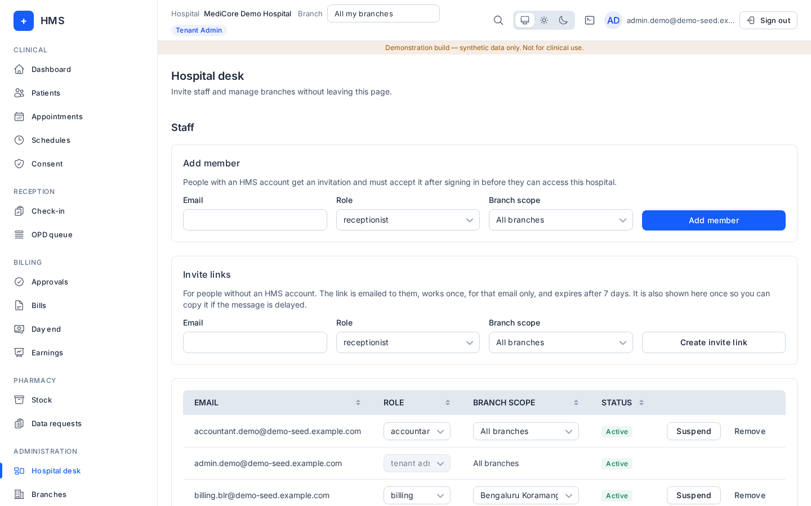
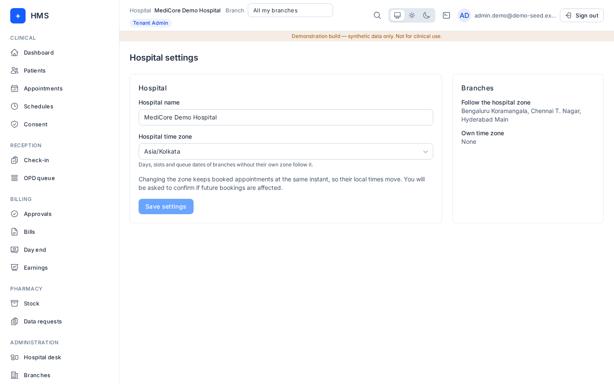

### Branches and GSTIN
1. **Administration → Branches**, press **Add branch**.
2. Fill **Branch name**, **Code**, **Branch time zone** (or tick **Use hospital time zone**), **Legal name**, **Address** and **GSTIN**. Press **Save branch**.
3. To change a branch, use **Edit branch**. Changing a time zone asks **Move future bookings?**.
4. **Deactivate** or delete a branch from **Actions**. A branch with open appointments or queue entries cannot be deleted. Tick **Show deleted branches** to find and restore one (it comes back inactive).

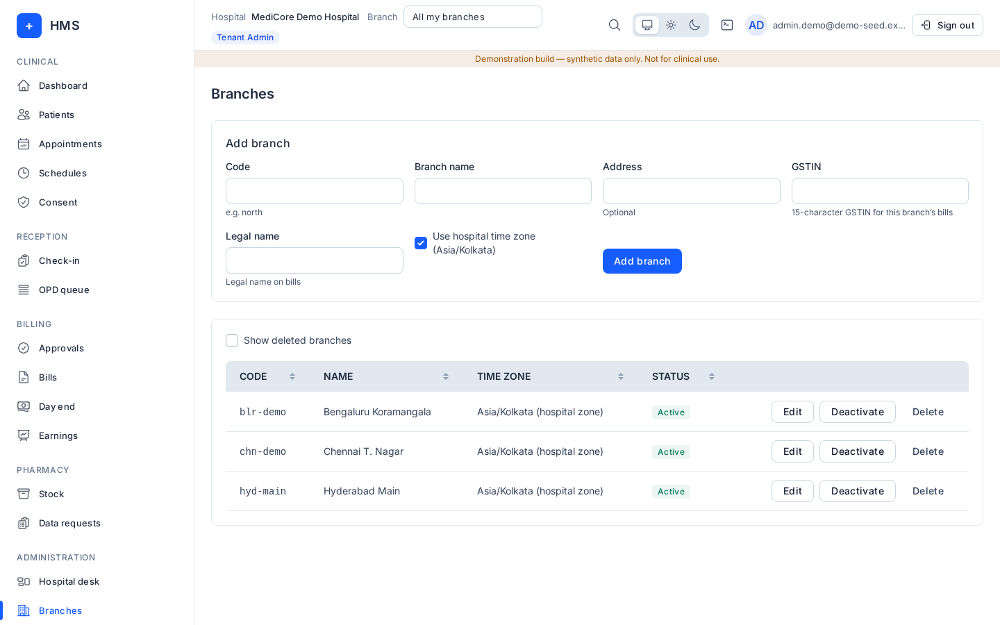

### Staff and roles (Members)
1. **Administration → Members**, press **Add member**.
2. Enter **Email**, pick a **Role** (tenant admin, doctor, nurse, receptionist, billing, pharmacist, lab technician, viewer, accountant) and a **Branch scope** (one branch or **All branches**). Tenant admins always cover all branches.
3. HMS answers "If an account exists for that email, an invitation has been sent."
4. You can change a member's role in the list, **Remove member**, or **Reactivate** them. You cannot change your own membership.
5. **Invite links** (on Members and Hospital desk): **Create invite link** for an email, role and branch scope; revoke links you no longer need.

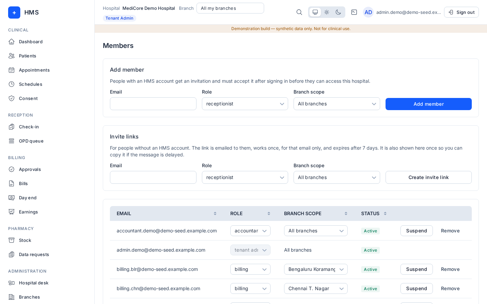

### Practitioners and working hours
1. **Administration → Practitioners → Add practitioner**: **Display name**, **Specialty**, **Department**, **Qualifications**, **Registration number** and **Council** (NMC details), **Phone**, **Email**, and **Staff account** (link the doctor's login so they see their own calendar and queue).
2. In **Branches and hours**, add the branch, **Room**, **Fee**, **Slot minutes**, days and times, mark a **Day off**, and set the **Travel buffer** (minutes between branches).
3. **Administration → Working hours** lists every schedule: **Add working hours** (practitioner, weekday, start time, end time, slot length, valid from/to). Overlapping hours, including at another branch, are refused.

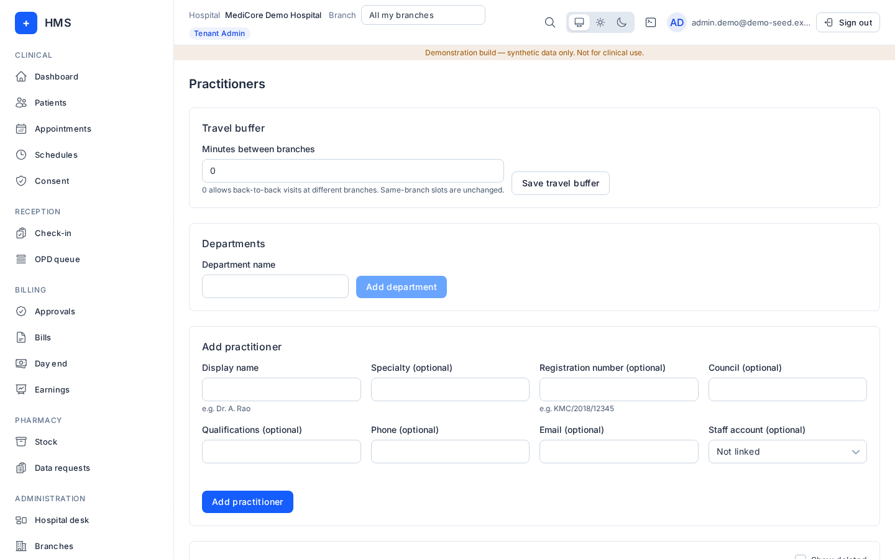
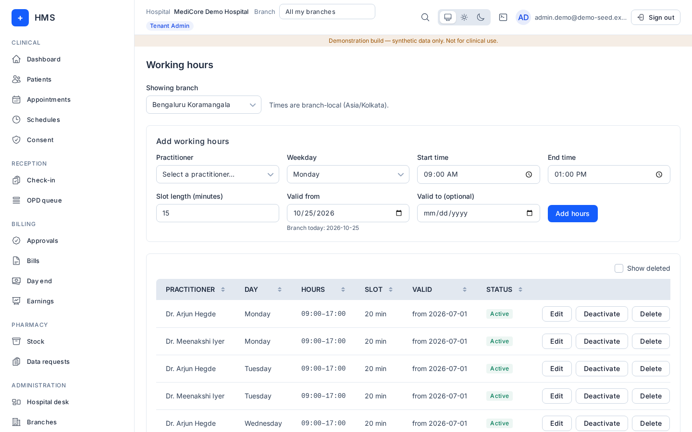
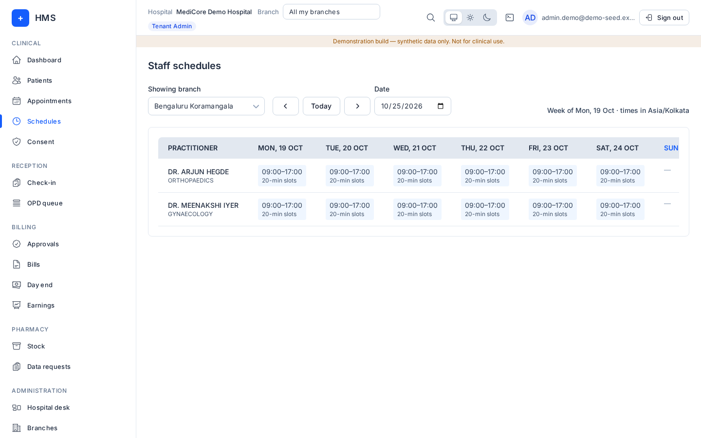

### Visit types
**Administration → Visit types** lists the five defaults: new consult, follow-up, review, emergency and teleconsult. For each, set **Fee (rupees)**, **Minutes** (5–240) and **Follow-up days** (0–366, blank for none), and optionally **This branch fee (rupees)** for the branch in the top bar. Press **Save**. Bookings already made keep their old fee and follow-up window.

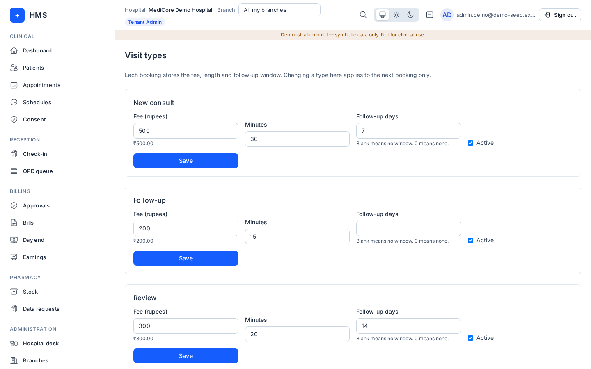

### Price list
1. **Administration → Price list → Add service** (name, category; the category sets the tax, e.g. "Healthcare service, GST exempt" or "Taxable service 18%").
2. **Set a price**: **Applies to** (Hospital, One branch or One practitioner), **Amount (rupees)**, **Effective from** and optional **Effective to**. Overlapping periods are refused.
3. **Import from CSV**: pick a **CSV file**, check the preview, then import. **Copy to a branch** copies a list (preview first).

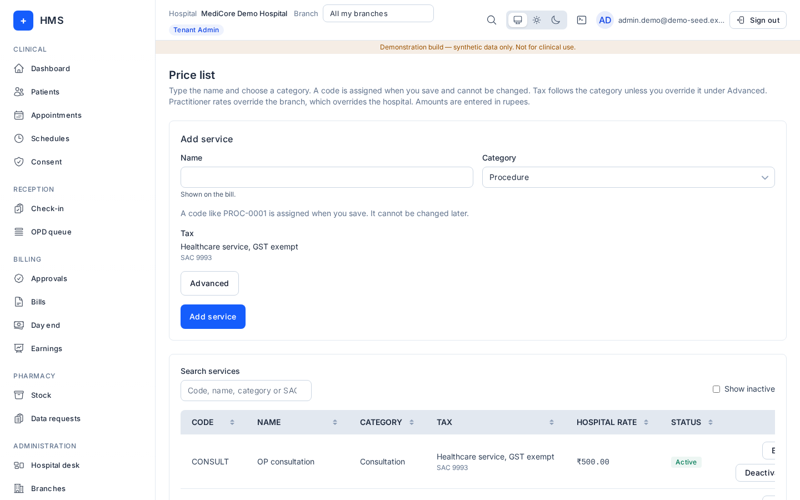

### Maker-checker settings and approvals
**Billing → Approvals**:
1. Set **Maker-checker above (rupees)**, **Cancel refund (%)** and **No-show refund (%)**, then **Save limits**. Discounts and refunds above the limit wait here for a second person.
2. Under **Pending approvals**, add a **Note** and press **Approve** or **Reject**.

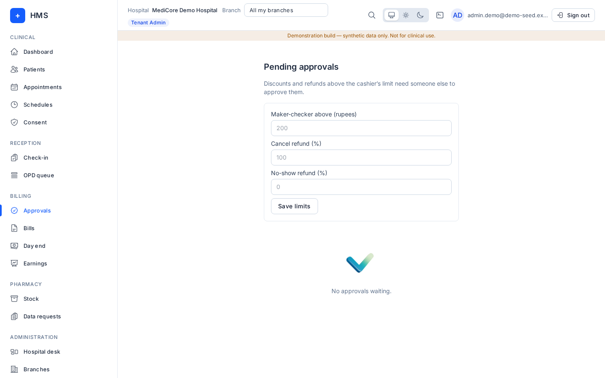

### Patient merge
1. Open the patient who should stay (**Patients**, click the name).
2. Press **Merge patient**, choose the **Duplicate chart**, enter a **Reason**, confirm.
3. Appointments and bills move to the kept chart; the duplicate is hidden and the merge is logged.

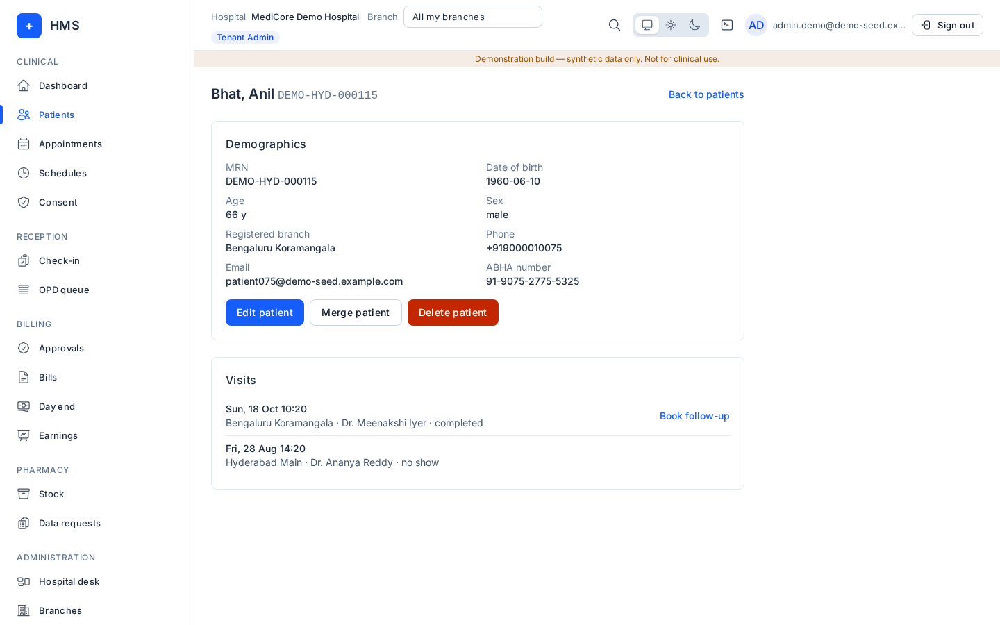
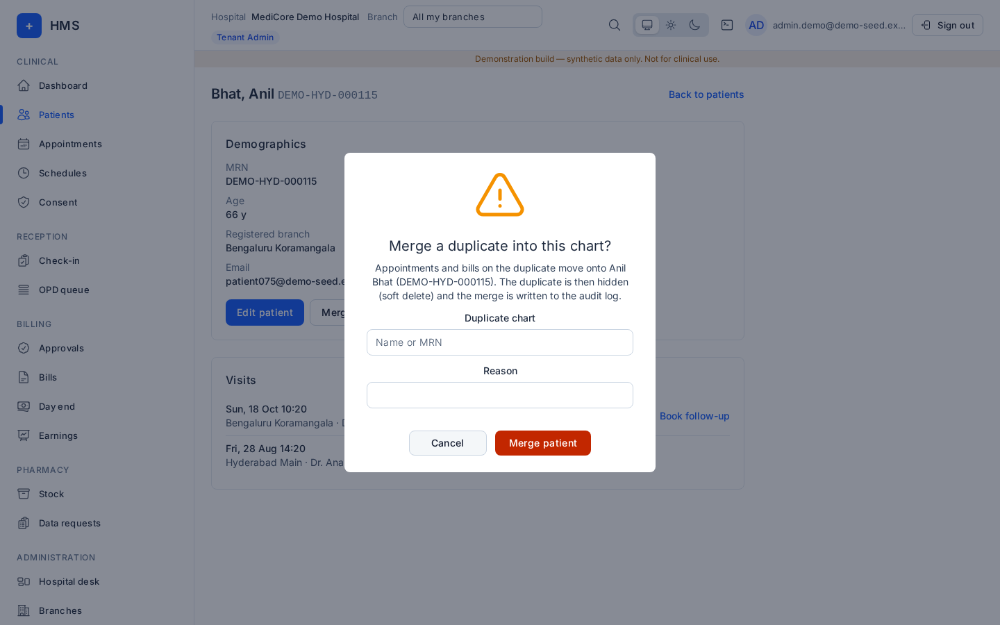

### Other admin screens
- **Hospital settings**: hospital name, time zone, default country code, and which branches follow the hospital zone.
- **Privacy notices**: write a **New draft** notice in English, Hindi, Tamil or Telugu, **Save draft**, and see **Versions**.
- **Data requests**: patient privacy requests (correction, nomination, erasure): **Verify identity**, **Fulfil**, **Approve erasure**, **Execute erasure**, **Close**.
- **Stock**: items, stores and opening stock (see [Other roles](other-roles.md)).
- **OPD queue → Close today early**: only when a branch must stop OPD before midnight (for example an emergency closure). Type a reason (3–500 characters) and confirm **Expire waiting tokens**; the reason is kept with the closed tokens. Otherwise the day closes by itself after midnight branch time.
- Everything reception and billing staff do is also open to you: see [Reception](reception.md) and [Billing](billing.md).

## Common errors
| Message | Meaning |
|---|---|
| Only tenant admins can … | The action is admin-only. |
| Could not delete …: branch has open appointments or queue entries. | Cancel or move those first. |
| That staff account is already linked to another practitioner. | Unlink it from the other practitioner first. |
| These hours overlap another active schedule of this practitioner … | Change the times or end the other schedule. |
| That price overlaps an existing effective period. | Set an end date on the old price first. |
| You cannot change your own membership. | Ask another tenant admin. |
| A queue day cannot be closed before it ends in the branch time zone. | Today has not ended at that branch. Use **Close today early** with a reason, or let it close after midnight. |

## FAQ
- **Is there an "owner" role?** No. The owner signs in as a tenant admin.
- **Can I give someone access to just one branch?** Yes: pick that branch as their **Branch scope**.
- **Does changing a visit-type fee change booked appointments?** No, only new bookings.
- **Where do GST numbers go?** On each branch (Branches → GSTIN).
